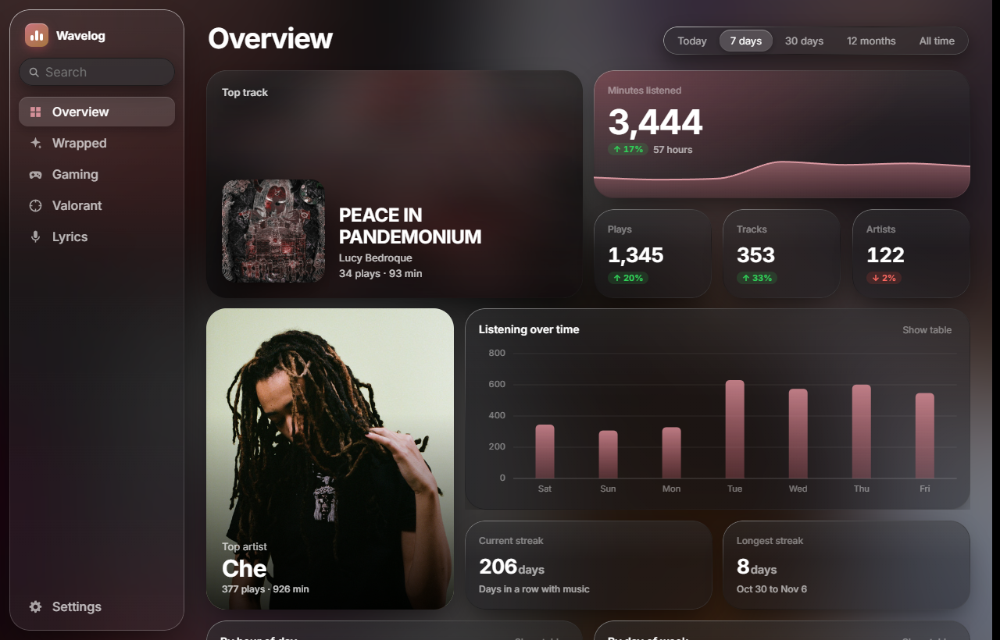
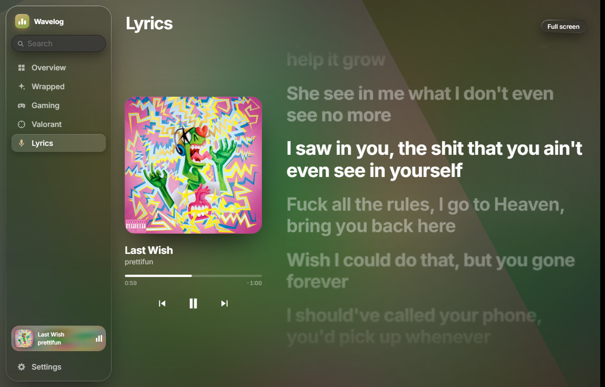
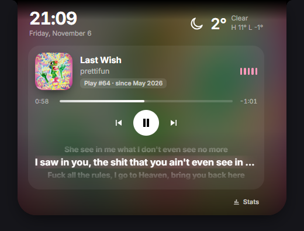
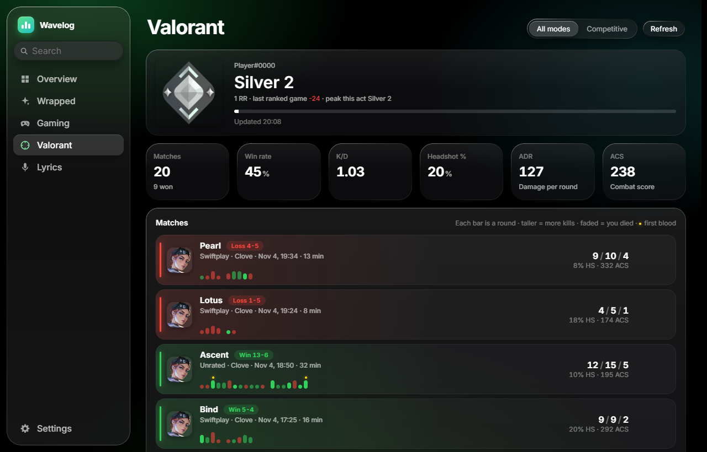

# Wavelog

A Windows app that records everything you play on Spotify and turns it into stats, desktop widgets and a Dynamic-Island-style notch. Liquid-glass look, everything stored on your own PC.

- **Stats window**: overview (minutes, streaks, top tracks/artists/albums, listening by hour and weekday, heatmaps, song of the day, most skipped), a Wrapped for any year, track and artist pages, full-screen karaoke lyrics, gaming time and a Valorant tracker.
- **Desktop widgets**: now playing, lyrics, calendar, photos, weather, PC monitor, clock, countdown, to-do, note, focus timer, Valorant. Real glass that refracts what's behind it, Small/Medium/Large, snapping, a widget stack.
- **Notch**: a pill at the top of the screen with the current song, live lyrics, media controls, Spotify volume and alerts. Hover it for a dashboard you can rearrange: clock, weather, focus timer, next event, PC load, to-dos, batteries, sound output, downloads and more.
- **Your PC in the notch**: mic and camera dots, screenshot and download pop-outs, notifications from your apps (sender and message, per-app mute), and a **file shelf**: drag files onto the notch to park them, drag them out later into a chat, a browser or a folder.
- **Imports**: your full Spotify history export, and every Last.fm scrobble.
- **Private**: no account and no server. Your listening database lives in `%APPDATA%\Wavelog`.

> Not affiliated with or endorsed by Spotify, Riot Games or Last.fm.



| Lyrics | Notch |
|---|---|
|  |  |



## Install

1. Download `Wavelog_x.y.z_x64-setup.exe` from [Releases](../../releases) and run it. It installs for your user only, no admin needed, and starts with Windows (switch in Settings → General). Windows SmartScreen may warn because the installer isn't code-signed yet: More info → Run anyway.
2. Create a Spotify app at <https://developer.spotify.com/dashboard>:
   - Redirect URI: `http://127.0.0.1:8721/callback`
   - API: Web API
3. Open the app (tray icon → Open stats), go to **Settings → General** and paste the app's **Client ID**.
4. Sign in when the browser opens. If it doesn't, use **Settings → Advanced → Sign in**.

Wavelog keeps logging in the background from the tray. `Ctrl+Alt+S` shows or hides the widgets.

Uninstall from Windows Settings → Apps. Tick *Delete the application data* to remove your listening database too.

Spotify apps in Development Mode only work for accounts you add to them in the dashboard, so everyone makes their own app (step 2).

### Fill in your history

- **Last.fm**: Settings → General → Last.fm, enter your username and a free API key from <https://www.last.fm/api/account/create>. Every scrobble is matched to a Spotify song and added. Plays you already have are skipped. After that it syncs every 30 minutes.
- **Spotify export**: request *Extended streaming history* at spotify.com → Account → Privacy settings (takes up to 30 days), then run `backend\import_history.py <export folder>` (see [Build from source](#build-from-source)).

## Troubleshooting

**Settings → Advanced** shows whether the logger and Spotify are connected, database size and play sources, every background job with its last error, and a live log. From there you can restart the logger, back up the database, clear caches, open developer tools and **Copy diagnostics** for a bug report. Diagnostics leave out your Windows username.

Files in `%APPDATA%\Wavelog` (`%APPDATA%\Spotify Stats` if you installed before the rename):

| File | What |
|---|---|
| `spotify.db` | SQLite database with your plays, tracks, artists and albums |
| `settings.json` | Settings |
| `config.json`, `tokens.json` | Spotify Client ID and sign-in. Keep these private |
| `app.log` | Log, rotates at 2 MB |
| `backups/` | A copy of the database every day (last 14 kept) and manual backups |

## Build from source

Needs Windows, Python 3.12+, Node 20+, Rust and the Visual Studio C++ Build Tools.

```powershell
# logger (Python)
python -m venv backend\.venv
backend\.venv\Scripts\pip install -r backend\requirements.txt pyinstaller
backend\.venv\Scripts\python -m PyInstaller --noconfirm --onefile --noconsole --name wavelog-logger `
  --add-data "backend\fonts;fonts" --collect-submodules uvicorn --collect-data recurring_ical_events backend\main.py
mkdir app\src-tauri\binaries -Force
copy dist\wavelog-logger.exe app\src-tauri\binaries\wavelog-logger-x86_64-pc-windows-msvc.exe

# app (Tauri + React)
cd app
npm install
npx tauri build
```

The installer lands in `app\src-tauri\target\release\bundle\nsis\`. Its icon and side images come from `app\src-tauri\installer\make_art.py`, and `installer\hooks.nsh` adds the extra install steps (closing the logger, Start with Windows, removing data on uninstall).

### Releasing an update

Installed copies check `releases/latest/download/latest.json` every few hours and offer the update in the sidebar and in Settings → About. Updates must be signed with the project's key:

1. Bump `version` in `app/package.json`, `app/src-tauri/tauri.conf.json`, `app/src-tauri/Cargo.toml` and `backend/version.py`.
2. Build with the signing key set (it stays outside the repo; keep a backup, without it existing installs can't be updated):
   ```powershell
   $env:TAURI_SIGNING_PRIVATE_KEY = "$HOME\.tauri\wavelog.key"; $env:TAURI_SIGNING_PRIVATE_KEY_PASSWORD = ""
   cd app; npx tauri build; cd ..
   python app\src-tauri\installer\latest_json.py "What changed"
   ```
3. Create a GitHub release tagged `v<version>` and upload `Wavelog_<version>_x64-setup.exe`, its `.sig` and `latest.json` from `app\src-tauri\target\release\bundle\nsis\`.

For development, run the logger with `backend\.venv\Scripts\python backend\main.py` (it keeps its data in `data\` next to the code) and the app with `npx tauri dev` in `app\`. `app\widget-test.html` renders any view in a normal browser with the Tauri API faked, e.g. `http://localhost:1420/widget-test.html?view=stats`.

## How it works

```
app/            Tauri 2 shell (Rust) + React UI, one window per widget, the notch and the stats window
  src-tauri/    windows, desktop layering, screen capture for the glass, media keys, audio meter
  src/          React views; glass.js is the WebGL glass shader
backend/        the logger: FastAPI on 127.0.0.1:8721, SQLite, runs as wavelog-logger.exe next to the app
```

- **Logging plays**: `currently-playing` every 5 to 20 s tracks each play and how long you heard it. Under 30 s counts as a skip. `recently-played` every 5 minutes fills in plays from other devices and corrects timestamps. `plays.source` is `live`, `recent`, `synced` (both agree), `history` (export) or `lastfm`.
- **Song details**: imports without album or cover info are looked up one by one in the background.
- **Glass**: each widget captures the screen just around itself at half resolution and a WebGL shader blurs, refracts and lights it. It never captures itself, so widgets show up in screenshots and screen shares.
- **Widgets** sit on the desktop under your apps and come back after Win+D. They pause while a fullscreen game is in front, unless set to *Over games*.
- **Valorant**: while the Riot Client runs, the logger reads its lockfile and calls Riot's own unofficial player endpoints for your account only (match history, RR, rank). It never touches the game. These endpoints can break after a patch.
- **Local API**: everything the UI shows comes from the logger. Browse it at <http://127.0.0.1:8721/docs> while the app runs.

## License

[MIT](LICENSE)
